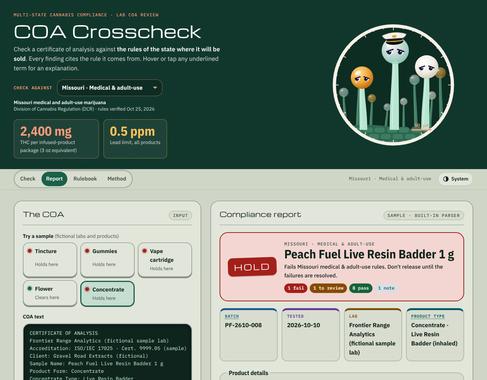
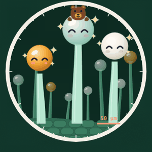
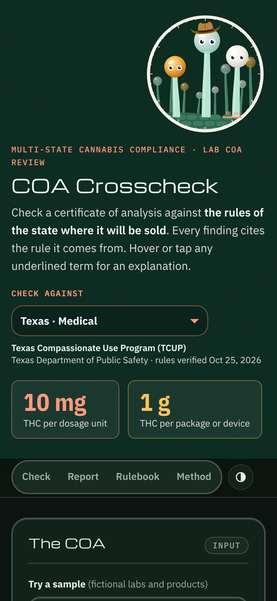

# COA Crosscheck

**Live demo:** https://scenebiscuit-cell.github.io/coa-crosscheck/

A browser tool that checks a cannabis lab **certificate of analysis (COA)** against the rules of the state where the product will be sold. Pick a rulebook, paste or upload a COA, and get a verdict where every finding cites the rule it comes from. Hover or tap any underlined term for a plain-language explanation.



## Rulebooks

| Rulebook | THC limits | Contaminant limits | Key sources |
|---|---|---|---|
| **Texas** · Medical (TCUP) | 10 mg per dosage unit; 1 g per package | Printed COA limits (rules defer to TDA) | 37 TAC §12.7; HB 46 (2025) |
| **Missouri** · Medical & adult-use | 3 oz per package: 85 g flower, 24 g concentrate, or 2,400 mg THC in infused products; THC shown as total and Δ9-only | State tables for metals (incl. chromium), 61 pesticides, and 20 solvents; inhaled vs. infused | 19 CSR 100-1.110, 100-1.120 (Code current through 10/31/26) |
| **Colorado** · Retail | 10 mg per serving; 100 mg per package (edibles) | State table; inhaled, oral, and topical tiers | 1 CCR 212-3, Rules 4-115, 4-210 |
| **Colorado** · Medical | No cap; must match label within ±15% | Same as retail | 1 CCR 212-3, Rules 4-115, 4-210 |
| **California** · Adult-use | 10 mg per serving, 100 mg per package (edibles); 1,000 mg (concentrates, topicals) | State table; inhalable vs. other | 4 CCR §§15717–15724, §17304 |
| **California** · Medicinal | Same, with 500 mg orally dissolving and 2,000 mg concentrates/topicals | Same as adult-use | 4 CCR §17304 |
| **Federal hemp** | 0.4 mg total THC per container from Dec 11, 2026; 0.3% by dry weight | None federally; states set panels | Hemp definition as amended; H.R. 6500 (2026) |

Each rulebook shows the date its citations were last verified, and [docs/VERIFY.md](docs/VERIFY.md) lists every value with its source and verification status. Where I couldn't confirm a specific rule (for example, how Colorado, California, and Missouri treat semi-synthetic cannabinoids), the checker flags the issue for review instead of failing it.

## What it checks

- **Product categories** from flower and concentrates to edibles, tinctures, capsules, and topicals. The category is read from the COA and can be changed on the page. For concentrates and vapes, a separate **concentrate type** (live rosin, shatter, badder, distillate…) is filled in when the COA names one. Flower and concentrate samples appear for every state that allows them (not Texas).
- **Required test panel** for the product type, including state-specific organisms (STEC, Salmonella, Aspergillus for inhaled products).
- **Contaminant results** against the state's own limits, picking the right tier for inhaled, oral, or topical products. It also flags labs that printed **looser limits than the state allows**, which happens when a lab reuses another state's action levels.
- **THC per serving and per package**, reconciling %, mg/g, mg/mL, and mg-per-unit results. Total THC follows each state's own definition: Colorado and Texas count Δ8, Δ10, and exo-THC, while California and Missouri count THC + THCA × 0.877.
- **Cannabinoid origin:** semi-synthetics such as HHC and THC-O-acetate, and Δ8 levels that suggest conversion from CBD.
- **Self-checks** that catch misreads: impossible values, and THC rows that don't add up to the lab's printed total.
- **Unsettled definitions shown both ways:** Missouri's rule says "800 mg of THC" without saying which THC, so the checker reports total THC and Δ9-THC only, and asks for review when the two land on opposite sides of the limit.
- **Date-aware rules:** the federal hemp per-container cap reports as "over the limit that starts Dec 11" until that date, then fails.

## Lab results on product pages

After a check, **Show these lab results on a product page** makes a card for shoppers: batch, lab, test date, total THC and CBD, each cannabinoid, and each safety test, with a link to the lab's full COA. No server is involved. The results travel inside the card itself.

- **A link** for menus on Dutchie, Leafly, and similar sites, QR codes, and email. The data sits after the `#`, so it never reaches a server.
- **Code** (a `<coa-card>` element) for pages the seller controls: their own site, a Shopify store, or a custom Dutchie Plus storefront.
- **JSON** for developers, in a documented, versioned format.

The compliance verdict appears on the card only if the seller confirms they checked the values against the COA. See [docs/SHARING.md](docs/SHARING.md).


## How it works

```
COA (paste / PDF / photo)  →  reader  →  structured fields  →  rulebook + rules engine  →  verdict + cited findings
                               │                ↑
       built-in parser, or an AI model     user can correct any field
       (local via Ollama)
```

Reading a COA is fuzzy, because every lab formats it differently. Judging compliance has to be exact and explainable. So reading and judging are kept apart:

- **`src/rules.js`** holds one rulebook per jurisdiction as plain data: limits, required tests, contaminant tables, and a citation link for each.
- **`src/core.js`** has the COA parser and the rules engine. These are pure functions, so they're easy to test.
- **`src/glossary.js`** holds the tooltip explanations.
- **`src/app.js`** is the interface.
- **`embed/`** has the shopper card (`coa-card.js`) and the page that opens results links (`card.html`).
- **`tests/`** has 50 unit tests covering each rulebook's key limits, the parser, and the shopper card, including fictional COAs in four common lab layouts (`tests/fixtures/`).

Adding a state means adding one rulebook object and its tests. The engine doesn't change.

### Reading COAs from different labs

No state standardizes the COA layout, so the built-in parser doesn't expect one. It looks for patterns that recur across labs:

- "Label: value" fields, including two on one line or the value on the next line
- section headers with a status, one-line summaries, and summary grids
- sideways cannabinoid tables and row tables with LOD, LOQ, and several result columns
- units in column headers or in a units row
- text copied from a PDF viewer, where columns are separated by single spaces
- CSV exports from lab software
- chemical names (Tetrahydrocannabinolic acid) as well as abbreviations (THCA)

When a COA is still misread, the self-checks flag it and every field can be corrected by hand. Scans and photos need the local AI model. To add a new layout, see [docs/HANDOFF.md](docs/HANDOFF.md).

## Design

The interface follows the 2026 trends that suit a professional tool ([Figma](https://www.figma.com/resource-library/web-design-trends/), [Envato](https://elements.envato.com/learn/web-design-trends), [We.inc](https://we.inc/blog/website-design-trends-2026)) and skips the purely decorative ones (3D, maximalism):

- **A playful header for a tedious job:** a microscope view of trichomes on the leaf surface, with smooth stalks and glossy resin heads in the clear, milky, and amber colors growers watch for, on a flat, film-grain forest green (no gradient). The three tallest have eyes that follow the cursor, blink, and react to each verdict (excited for Clear, with rosy cheeks and sparkles; heavy skeptical eyelids for Review; sad eyes and a tear for Hold). The tallest one dresses for the state: a cowboy hat for Texas, a ski beanie for Colorado, a riverboat captain's cap for Missouri, a grizzly cub on its head for California, and an old-school black government fedora for federal hemp. They're decorative and hidden from screen readers, and they stay still for people who prefer reduced motion.


- **Color-coded test categories:** each kind of test (cannabinoids, solvents, pesticides, microbials, metals, and more) has its own hue and a larger, bolder heading, so a long COA is quicker to scan. Every hue passes WCAG AA contrast in both themes.
- **Retrofuturist instrument panel:** below the microscope header, the page is styled like a mid-century lab instrument: enamel panels with chrome trim, capsule buttons that press in, THC results on dark phosphor readout screens, and indicator lamps beside each finding. The period display face (Michroma) is kept to short titles; everything people read stays in IBM Plex Sans. The skin lives in `src/retro.css`, separate from the base styles.
- **Accessibility as a baseline:** passes an automated WCAG 2.2 AA audit (axe-core) in light and dark themes, with a skip link, visible focus, keyboard-reachable tooltips, and 24 px minimum tap targets.
- **Frosted sticky section nav** with a scroll-progress line driven by CSS scroll timelines.
- **Native view transitions** when switching rulebooks, and **purposeful micro-interactions** only where state changes. All motion turns off for people who've asked their device for reduced motion.
- **Bento layout** for the report summary and the rulebook.
- **Dark mode with a manual toggle** (system, light, dark).
- **Conversational AI:** an "Ask about this result" box answers questions in plain language using a local model, or Claude or an OpenAI-compatible service with your own API key, and only from the report and the selected rulebook.

## Use a local AI model (Ollama)

The built-in parser handles simple layouts and many common lab layouts. For any layout, including scanned PDFs and photos, connect a model running on your own computer. The COA never leaves your machine. Once connected, the **Ask about this result** box can also use the model to answer questions about the report (choose **Local model** under **Answer with**).

1. Install [Ollama](https://ollama.com), then `ollama pull qwen2.5:14b` (optionally `ollama pull qwen2.5vl:7b` for photos and scans).
2. Allow the site: in PowerShell, `setx OLLAMA_ORIGINS "https://scenebiscuit-cell.github.io"`, then quit and restart Ollama. This isn't needed when the page runs from `http://localhost`.
3. Open **Use a local AI model** on the page and click **Connect**.

## Ask with a cloud AI

The **Ask about this result** box can answer with Claude, or with OpenAI or any OpenAI-compatible service such as OpenRouter. It uses *your own* API key: there is no server and no key of ours, and the page calls the provider directly from your browser.

1. Get an API key from [Anthropic](https://console.anthropic.com), [OpenAI](https://platform.openai.com), or [OpenRouter](https://openrouter.ai).
2. Open **Use a cloud AI model** on the page and paste the key. Claude defaults to `claude-haiku-5-5`; for an OpenAI-compatible service, also enter the base URL (OpenAI's is prefilled) and a model name.
3. In the Ask box, pick **Answer with** Claude or OpenAI-compatible, then ask. **Stop** cancels an answer in progress.

What to know:

- **What's sent:** your question, the report, and the COA's results go to the provider you picked, under your account, and their usage charges apply. Nothing goes anywhere else. The built-in checker and the shopper card never use your key.
- **Where the key lives:** in this browser tab's memory, gone when you close or reload the tab. **Remember on this device** saves it in this browser's storage in plain text, so leave it off on a shared computer.
- **If it fails:** the page explains a wrong key, a rate limit or spending cap, or a wrong model name. If the browser blocks the request outright, the service doesn't allow calls straight from a web page.

## Continue development

[docs/WORKFLOW.md](docs/WORKFLOW.md) is the everyday workflow: Claude Code in VS Code for changes and Copilot for autocomplete. Both read the same project rules (`CLAUDE.md` imports `.github/copilot-instructions.md`). [docs/HANDOFF.md](docs/HANDOFF.md) covers Copilot on its own. The repository includes Copilot instructions and reusable prompts for adding a lab layout, updating a rule, and syncing a new version. A GitHub Actions workflow runs the tests on every push.

## Run it locally

```bash
git clone https://github.com/scenebiscuit-cell/coa-crosscheck.git
cd coa-crosscheck
python3 -m http.server 8000   # then open http://localhost:8000
npm test                      # Node 18+, no dependencies
```



## Disclaimer

This is a portfolio project, not legal advice. Cannabis rules change often, so check the cited sources before relying on a result. Sample COAs, labs, and companies are fictional.

---

Created by **Nick Lax** · nlaxatx@gmail.com · MIT License
