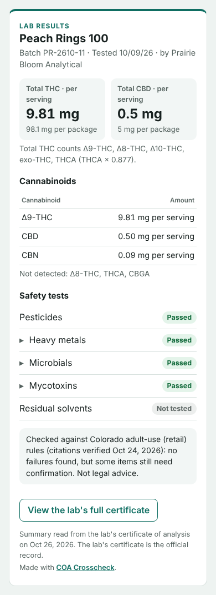

# Showing lab results on a product page

COA Crosscheck turns a lab's certificate of analysis (COA) into a lab-results card for shoppers. The card shows the batch, lab, test date, total THC and CBD, each cannabinoid, and each safety test. It can also link to the lab's full COA.



## Make a card

1. Open [COA Crosscheck](https://scenebiscuit-cell.github.io/coa-crosscheck/), pick your state, and check the COA.
2. Open **Lab results as read** and compare it with the COA. Fix any product details the reader got wrong.
3. Open **Show these lab results on a product page**.
4. Optional: paste a link to the lab's COA PDF. Shoppers get a **View the lab's full certificate** button.
5. Copy the link or the code (see below).

A COA covers one batch. When a new batch goes on sale, make a new card from its COA.

**About the rule check.** By default the card shows the lab's numbers only. If you tick **I compared Lab results as read with the COA** and then **Also show the result of the rule check**, the card adds one line, such as "Checked against Texas medical rules (citations verified Oct 25, 2026): no conflicts found. Not legal advice." Shoppers may read that line as a guarantee, so add it only after checking the values yourself.

## Where to use it

| Where your products are listed | Use | How |
|---|---|---|
| Dutchie, Leafly, Jane, or another hosted menu | **Link** | Paste the link into the product description, or anywhere the menu accepts a link. Check the platform's rules on outside links first. |
| Shelf talkers, signs, or receipts | **Link** in a QR code | Make the QR code with any QR generator. The link is long, so the code is dense: print it at least 2 inches (5 cm) wide and test it with a phone. Small codes on packaging need a short link, which needs a server. |
| Email or text to a patient or customer | **Link** | Paste it in. |
| Your own website, a Shopify store, WordPress, Squarespace | **Code** | Paste it into a custom HTML or code block on the product page. |
| A site builder that strips scripts | **Code**, with **Use a frame instead** ticked | Paste it into an embed or HTML block. |
| A custom storefront built on Dutchie Plus or another API | **Code** or **Download data (JSON)** | Your developer can drop in the `<coa-card>` element or render the JSON in your own design. |

## Privacy

- Nothing is uploaded. The COA is read in your browser.
- The results travel inside the link or the code. In a link, they come after the `#`, which browsers don't send to any server, so GitHub (which hosts the page) never sees them.
- Anyone with the link can see the card, the same as a COA PDF you post.

## Limits

- The card shows what was read from the COA. The lab's certificate is the official record, and the card says so.
- Someone could edit the code or the data and change the numbers. A card isn't proof on its own; the linked COA is.
- Links are about 900 to 1,500 characters long. That's fine in browsers and most text fields, but some platforms may cut long links.

## For developers

**Script element.** Load the script once per page, then add one card per product:

```html
<script src="https://scenebiscuit-cell.github.io/coa-crosscheck/embed/coa-card.js" defer></script>
<coa-card>
  <script type="application/json">{ "schema": "coa-card/1", ... }</script>
</coa-card>
```

The data can also come from:
- `src="results.json"`: a file on your own server
- `data-card="z1...."`: the packed string from a link, after the `#`
- the element's `.card` property, set from your own code

Change the accent color with `coa-card { --coa-accent: #7a2e8f; }`, and force a theme with `theme="light"` or `theme="dark"`. The card uses your page's font.

**Packing and unpacking links.** `COACard.encode(card)` returns the packed string (compressed JSON, URL-safe), and `COACard.decode(string)` returns the card.

**Data format (`coa-card/1`).** Fields marked ? can be null.

```text
schema        "coa-card/1"
made          "YYYY-MM-DD", the day the card was made
product       { name?, form?, batch?, units?, unitSize?, net? }      e.g. unitSize "4.5 g", net "45 g"
lab           { name?, accreditation? }
dates         { sampled?, tested?, reported? }                       as printed on the COA
coaUrl?       http(s) link to the lab's COA
thc?, cbd?    { perUnit?, perPkg?, conc?: { value, unit: "%" | "mg/mL" } }    mg; thc also has counts: ["Δ9-THC", ...]
cannabinoids  [{ name, result, value, unit }]                        result as printed, e.g. "ND"; value is a number (ND = 0)
tests         [{ name, status, items: [{ name, result?, limit?, unit?, over? }] }]
                status: "pass" | "fail" | "not tested" | "reported" (results listed, no overall status)
review?       { verdict: "clear" | "review" | "hold", rules, verified }    only when the seller opted in
```

Version 1 cards will keep working. New optional fields may be added, so ignore fields you don't recognize.
